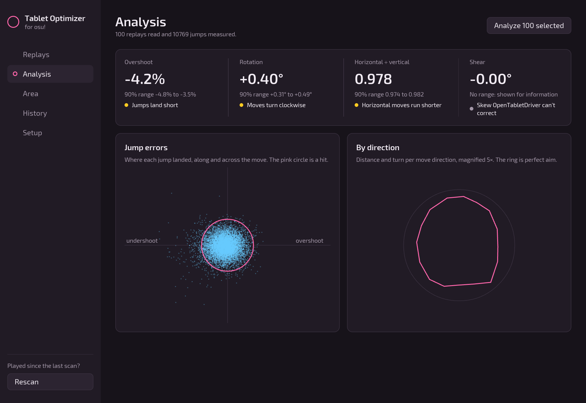
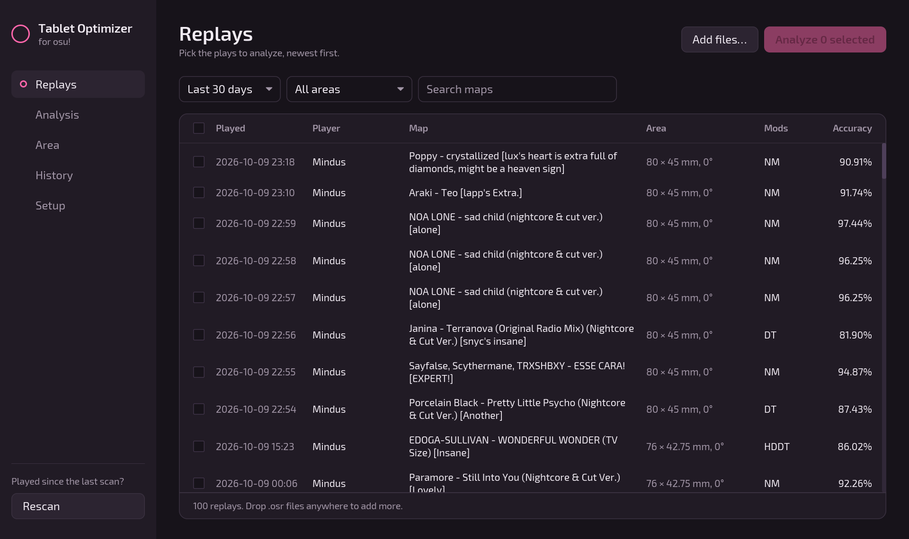
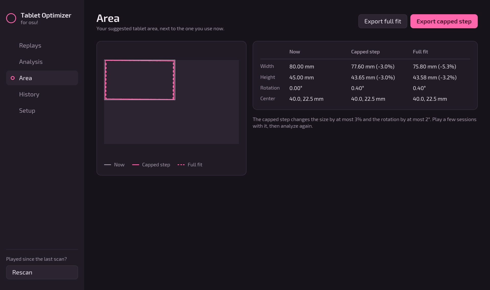
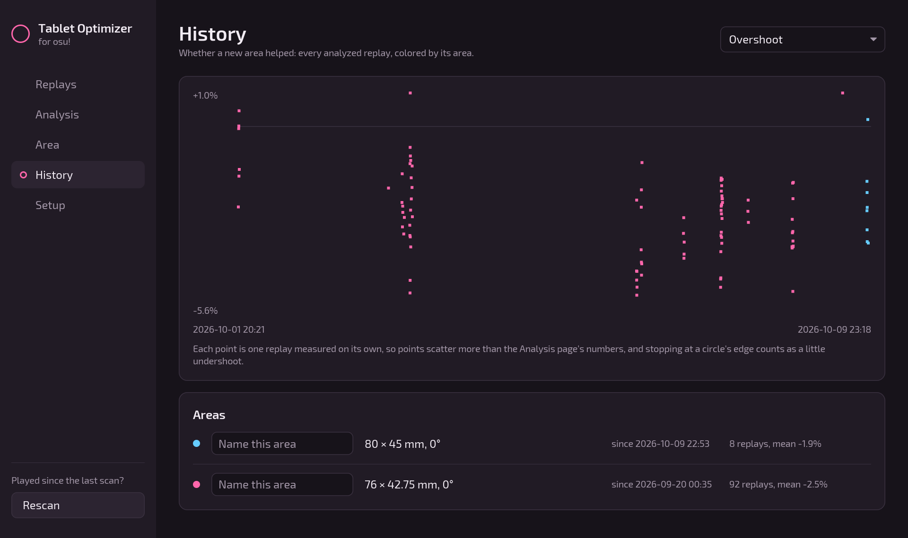

<p align="center">
  
</p>

<h1 align="center">osu! Tablet Optimizer</h1>

<p align="center">
  <strong>Fit your tablet area to how you actually aim.</strong><br>
  Reads your osu! replays, measures where your jumps land, and suggests a better<br>
  <a href="https://github.com/OpenTabletDriver/OpenTabletDriver">OpenTabletDriver</a> area: size, aspect ratio and rotation.
</p>

<p align="center">
  <a href="https://github.com/Mindus1/osu-tablet-optimizer/releases/latest"></a>
  
  
  
</p>

<p align="center">
  
</p>

Most players set their tablet area by feel. When your jumps keep landing a little short, the area is a little too large; when they drift to one side, it's turned. Those biases are a few percent and a few tenths of a degree: too small to notice by feel, but steady enough to measure.

osu! Tablet Optimizer measures them from hundreds or thousands of your own jumps, says how sure it is, and turns them into an area you can apply: a careful step to try today, and the full correction.

## What it does

<table>
  <tr>
    <td width="50%" valign="top">
      
      <p><strong>Finds your replays.</strong> Standard osu!stable and osu!lazer installs are found on their own; add any other folder in Setup. Filter by session, date, tablet area or map, or drop <code>.osr</code> files onto the window.</p>
    </td>
    <td width="50%" valign="top">
      
      <p><strong>Suggests an area.</strong> A capped step (at most 3% and 2°) and the full fit, kept on your tablet when its size is known, exported as an OpenTabletDriver preset. Your <code>settings.json</code> is never touched.</p>
    </td>
  </tr>
  <tr>
    <td width="50%" valign="top">
      
      <p><strong>Shows whether it helped.</strong> Every area change is logged from OpenTabletDriver's settings, and every analyzed replay becomes a point colored by the area it was played with.</p>
    </td>
    <td width="50%" valign="top">
      <p><strong>Works with your setup.</strong></p>
      <ul>
        <li>Any tablet OpenTabletDriver supports; its size comes from OpenTabletDriver's tablet list.</li>
        <li>Installed or portable OpenTabletDriver 0.6, in absolute mode (or Artist Mode on Linux).</li>
        <li>Keyboard or pen-tap clicking: any press counts.</li>
        <li>Mods that only change looks or speed are fine, and HR, EZ, Mirror and Difficulty Adjust are accounted for. Replays with other mods, such as Relax, Autopilot or ones that move objects, are skipped.</li>
        <li>Everything stays on your computer. Nothing is uploaded.</li>
      </ul>
    </td>
  </tr>
</table>

## How it works

For every jump that starts at a circle and is at least three circle radii long (by default), the app compares where you meant to go, from your cursor at the previous hit to the next object, with where your cursor was when you pressed. Presses more than three radii off are left out as misses. Across all jumps it fits

$$\text{actual} = B \cdot \text{intended} + k \cdot \text{direction}$$

$B$ is your effective gain: how far, how turned and how stretched your moves come out. $k$ soaks up the habit of stopping at a circle's edge, which doesn't grow with jump distance the way a wrong area size does. $B$ then translates into OpenTabletDriver's width, height and rotation.

The 90% ranges come from resampling whole replays 200 times, because aim shifts from session to session, so the jumps of one session aren't independent. A change is only suggested when its range rules out "no change", and it needs at least 5 replays and 50 usable jumps in total.

## Download

Each [release](https://github.com/Mindus1/osu-tablet-optimizer/releases) has a build for each platform:

| Platform | File | To start |
|---|---|---|
| Windows | `osu-tablet-optimizer-windows-x64.exe` | Run it. |
| macOS (Apple silicon) | `osu-tablet-optimizer-macos-arm64.tar.gz` | Unpack it and move *osu! Tablet Optimizer* to Applications. |
| Linux | `osu-tablet-optimizer-linux-x64.tar.gz` | Unpack it and run `osu-tablet-optimizer`. |

The builds aren't signed by a publisher, so Windows SmartScreen may ask before the first start. macOS blocks the app the first time; allow it under *System Settings → Privacy & Security → Open Anyway*.

On Linux, the archive also holds a launcher entry with the app's icon. To add the app to your app menu:

```sh
install -Dm755 osu-tablet-optimizer ~/.local/bin/osu-tablet-optimizer
install -Dm644 osu-tablet-optimizer.desktop ~/.local/share/applications/osu-tablet-optimizer.desktop
install -Dm644 osu-tablet-optimizer.png ~/.local/share/icons/hicolor/256x256/apps/osu-tablet-optimizer.png
```

## Quick start

1. **Setup** opens on first start. Check that your osu! folders and OpenTabletDriver were found, and pick your tablet's profile.
2. **Replays:** pick a few sessions of recent plays with your current area, then press *Analyze*.
3. **Analysis** shows how your jumps land. **Area** shows what to change; export the capped step.
4. In OpenTabletDriver, apply the preset under *File → Presets*. Play a few sessions with it.
5. Press *Rescan*, analyze your new replays, and see on **History** whether it helped.

<details>
<summary><strong>Every page in detail</strong></summary>

<br>

**Setup**
- **osu! folders:** stable and lazer are detected. Add other folders with *Add folder…*.
- **OpenTabletDriver:** found automatically when it's installed. For a portable OpenTabletDriver, *Choose folder…* and pick its program folder; the `userdata` folder inside is used.
- **Profile and tablet:** pick your tablet's profile. The tablet's size comes from OpenTabletDriver's tablet list, or you can enter it yourself.
- **Players:** filled in after the first scan with the name that appears most in your replays. Edit it if you share the PC.

**Replays** lists your osu!standard replays, newest first.
- **Filter:** by last session, 7 days, 30 days or all time, by tablet area, or search map titles. Analyze your current area's replays: the suggestion corrects your current area, so replays played with an older one would blur it.
- **Add replays:** with *Add files…* or by dropping `.osr` files onto the window.
- **Area column:** the tablet area each replay was played with. When it's wrong, select the replays and pick the right one under *Assign selected to area…*; *By date* undoes that.

**Analysis** measures the jumps in the selected replays (at least three circle radii long by default; you can change this in Setup). Overshoot, rotation and horizontal ÷ vertical come with a 90% range; when that range includes "no change", the page says *no clear effect*.
- **Overshoot:** how much farther (+) or shorter (−) than intended your jumps travel.
- **Rotation:** how many degrees your moves come out turned clockwise (+) or counter-clockwise (−).
- **Horizontal ÷ vertical:** below 1 means horizontal moves fall shorter than vertical ones.
- **Shear:** a skew OpenTabletDriver can't correct; shown for information.
- **Jump errors:** each dot is one jump's landing point, along the move (right is too far) and across it. The pink circle is a hit.
- **By direction:** distance and turn per move direction, magnified 5×. The ring is perfect aim; an outline inside it means undershoot. Directions with fewer than 10 jumps are left open.

**Area** draws the suggested area over your current one. It needs an analysis made with OpenTabletDriver's settings found, and a profile in absolute mode.
- **Capped step:** changes the size by at most 3% and the rotation by at most 2°; you can change these limits in Setup.
- **Full fit:** the whole correction the analysis measured.
- Size, aspect ratio and rotation stay as they are when the analysis shows no clear effect.
- **Export:** saves a preset named like `oto-2026-10-09-capped` with your other settings copied as they are. The area keeps its center, moved only as far as needed to stay on the tablet. If OpenTabletDriver is running, use *Refresh presets* before applying it.

**History**
- **Areas:** your profile's area is logged whenever it differs from the last one, at start and before each scan. Each area counts from the time OpenTabletDriver saved its settings, so replays from before the first logged area are *unknown*. Saving any other OpenTabletDriver setting also updates that time; assign replays by hand when that matters. Picking another profile or folder in Setup replaces the last logged area, because that change has no date of its own.
- **Chart:** each analyzed replay adds a point. Points are measured from one replay each, so they scatter more than the Analysis page's numbers, and stopping at a circle's edge counts as a little undershoot. The list shows each area's mean.

</details>

<details>
<summary><strong>Where your data lives</strong></summary>

<br>

Settings (`config.json`), the history (`history.json`) and the scan cache (`library.json`) are in your app data folder under `osu-tablet-optimizer`: `%APPDATA%` on Windows, `~/.local/share` on Linux, `~/Library/Application Support` on macOS. OpenTabletDriver's own settings are only read, and presets are always new files.

The first scan of a large library takes a minute or two; later scans only read new or changed files.

</details>

## Build from source

Requires [Rust](https://rustup.rs) (stable).

```sh
cargo run --release
```

## Credits

- Tablet dimensions in `src/core/tablets.tsv` come from [OpenTabletDriver](https://github.com/OpenTabletDriver/OpenTabletDriver)'s tablet configurations (LGPL-3.0).
- The interface uses [Exo 2](https://github.com/googlefonts/Exo-2.0) (SIL Open Font License 1.1, see `assets/fonts/OFL.txt`).
- Not affiliated with osu! or ppy Pty Ltd.
